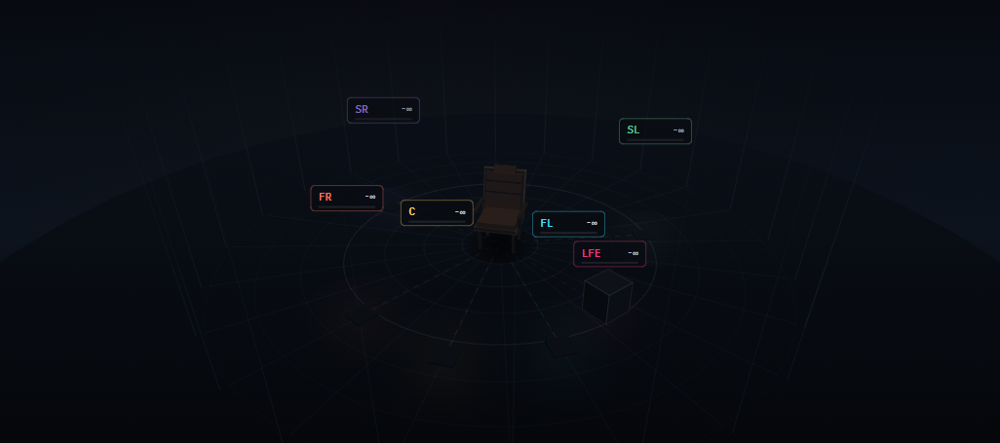

# 🎛️ Surround-field

**A serverless, in-browser 3D multi-channel audio visualizer and routing matrix.**

Surround-field is a single-file web application built entirely with Vanilla JS, the Web Audio API, and Canvas 2D. It allows audio engineers, home theater enthusiasts, and developers to visualize, route, and meter multi-channel audio (from 1.0 Mono up to 7.1.4 Atmos) directly in the browser. 

**No uploads. No servers. 100% local processing.**

👉 **[Try the Live Demo](https://akuncadangans1tu-beep.github.io/Surround-Field/)**

## ✨ Features

- **Auto-Routing Matrix:** Automatically detects source channel count (1 to 12 channels) and builds the optimal up-mix or fold-down matrix. Discrete height channels for 5.1.4 and 7.1.4.
- **3D Listening Room:** Real-time Canvas 2D rendering of a listening environment with interactive orbit camera, acoustic bounce lighting, and dust particles.
- **Pro Metering:** BS.1770 K-weighted LUFS-M metering, L/R Goniometer (phase scope), and per-channel scrolling spectrograms.
- **Calibration Tools:** Built-in tone generator (Pink Noise, 440Hz Sine, 20-20k Sweep), polarity inversion per bus, and speaker distance-to-AVR delay calculator.
- **Zero Dependencies:** No React, no Webpack, no backend. Just one highly optimized HTML file.

## 🚀 How to Use

1. Open the [Live Demo](https://akuncadangans1tu-beep.github.io/Surround-Field/).
2. Drag and drop any multi-channel audio file (WAV, FLAC, MP4, MKV) into the room, or click **DEMO** to hear a synthesized 5.1 test track.
3. Use the **RACK** drawer to solo/mute channels, adjust the up-mix matrix, and view per-channel spectrograms.
4. Drag the 3D room to orbit, scroll to dolly, and shift-drag to change camera height.

## ⌨️ Keyboard Shortcuts

| Key | Action |
| :--- | :--- |
| `Space` | Play / Pause |
| `←` / `→` | Seek backward / forward 5s |
| `1` - `6` | Solo channel 1-6 |
| `Shift` + `1-6`| Mute channel 1-6 |
| `0` | Clear all solo/mute |
| `T` | Toggle Tone Generator |
| `C` | Cycle Camera Presets |

## 🛠️ Tech Stack

- **Audio:** Web Audio API (`AudioContext`, `ChannelSplitter`, `BiquadFilter`, `DynamicsCompressor`)
- **Graphics:** HTML5 Canvas 2D (Custom 3D projection, painter's algorithm, radial gradients)
- **UI:** Vanilla JS, CSS Grid, custom CSS variables.
- **Hosting:** GitHub Pages

## 📄 License

Licensed under the **GNU AFFERO GENERAL PUBLIC LICENSE V3.0**. 
*(You can use, modify, and distribute it freely, even commercially. However, if you modify and share it—or host a modified version as a web service—you must release your source code under the same AGPL v3.0 license. See `LICENSE` in the app's legal menu for details).*
